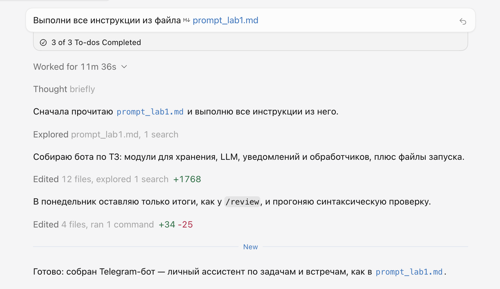
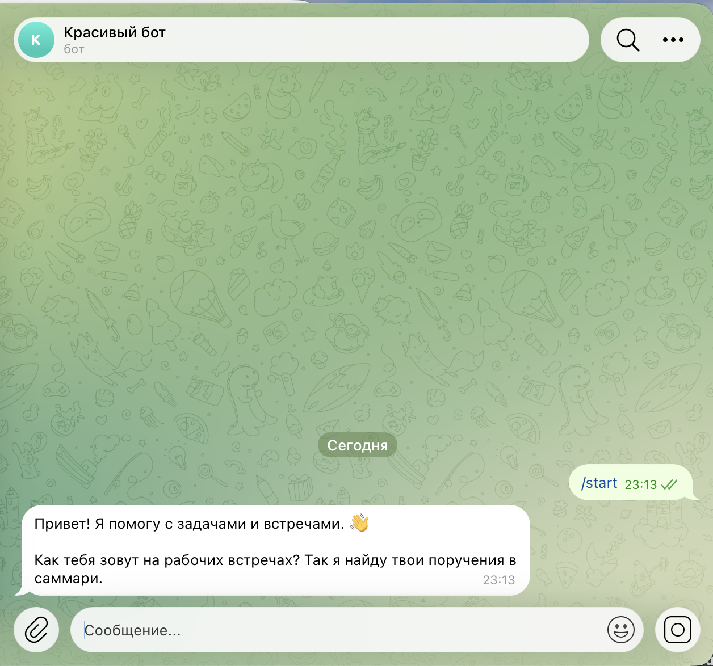
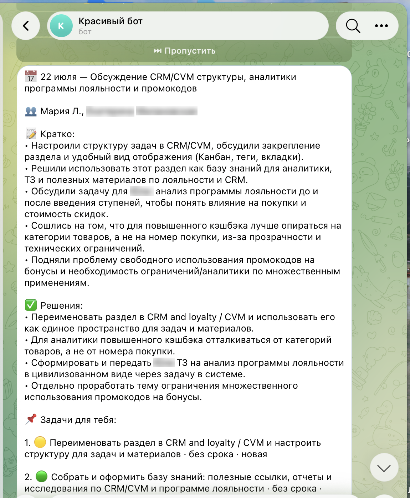
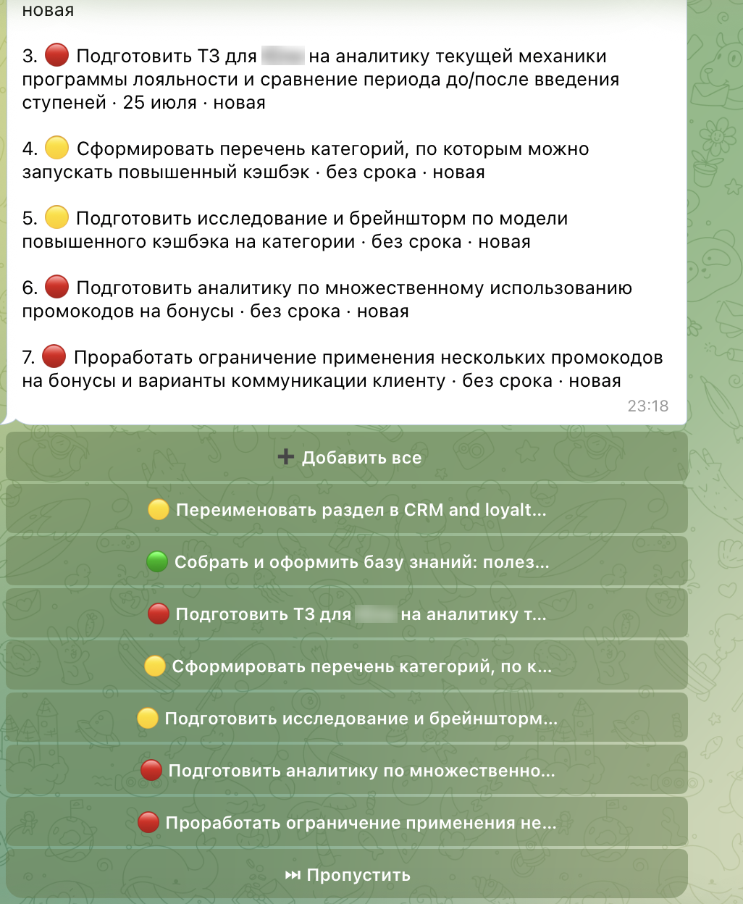
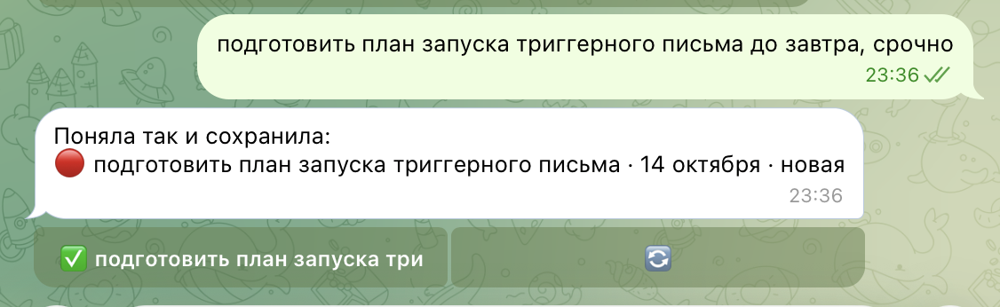
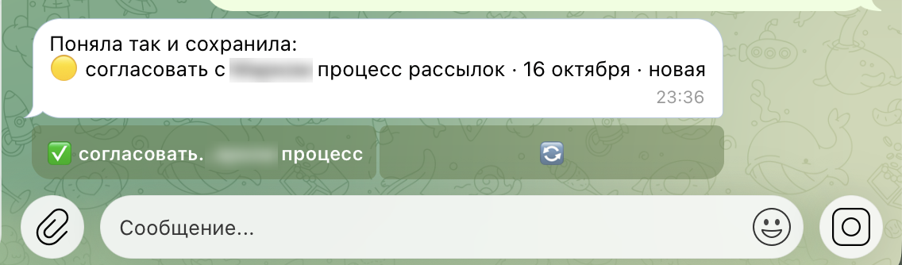
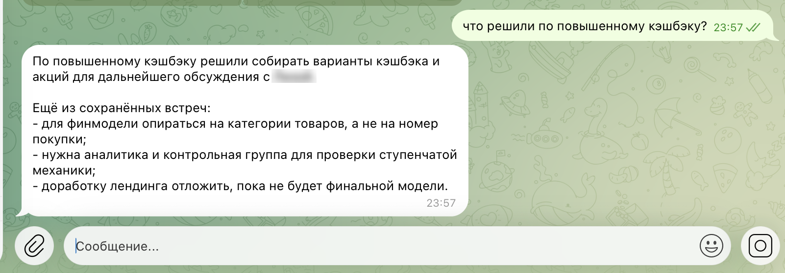
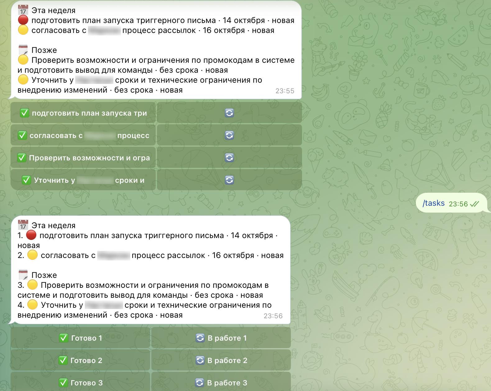
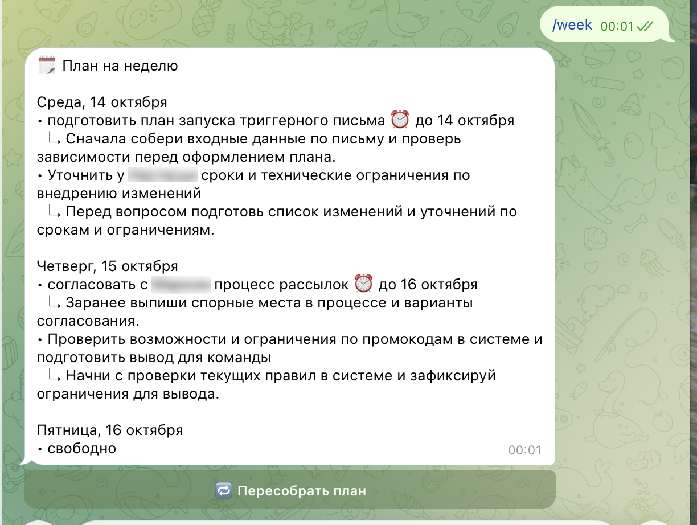
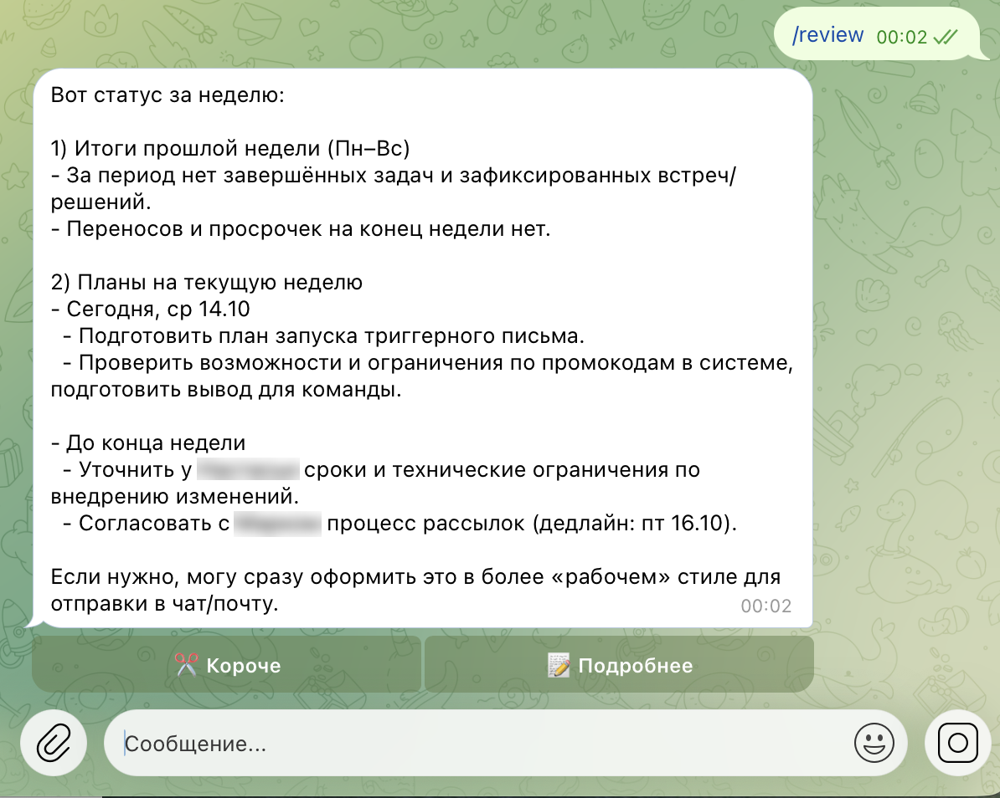

University: [ITMO University](https://itmo.ru/ru/)
Faculty: [FICT](https://fict.itmo.ru)
Course: [Vibe Coding: AI-боты для бизнеса](https://github.com/itmo-ict-faculty/vibe-coding-for-business)
Year: 2026/2027
Group: VibeCod УВБ 3
Author: Levina Maria Yurievna
Lab: Lab1
Date of create: 13.10.2026
Date of finished: XX.XX.2026

# Лабораторная работа 1. Создание первого Telegram-бота без программирования

**Бот:** [@itmoftmi_lmy_bot](https://t.me/itmoftmi_lmy_bot) («Красивый бот»)
**Видео-демо:** [смотреть на Google Диске (2 мин)](https://drive.google.com/file/d/1kIi4FH84HTokMp_NZpI0CwwDhtLTOJR8/view?usp=sharing)

## 1. Описание задачи

### Какую проблему решает бот

После рабочих встреч у меня остаются саммари от саммаризатора: текстовые файлы, в которые потом никто не заглядывает. Задачи из них теряются, договорённости забываются, а перед следующей встречей приходится вспоминать, что обещали в прошлый раз.

«Красивый бот» — личный ассистент, который превращает эти файлы в рабочую систему:

- принимает саммари встречи (`.txt`), выделяет из него решения и **мои** задачи со сроками;
- принимает задачи обычным текстом («подготовить отчёт для Ани до пятницы, срочно») и сам определяет срок и приоритет;
- обновляет статусы фразами вроде «отчёт сделала» или «перенеси презентацию на среду»;
- отвечает на вопросы по истории встреч («что решили по кэшбэку?»), собирая ответ из нескольких встреч;
- составляет план на неделю, а также итоги недели и планы для руководителя;
- напоминает о сроках: сводка в 9:00 по будням, напоминание в 18:00 накануне дедлайна, пинг в 15:00 в день дедлайна.

### Почему выбрана эта задача

Это моя реальная боль: саммаризатор у меня уже есть, но результат его работы — «файл, в который лень лезть». Обычные ИИ-помощники в Zoom или Meet пересказывают одну встречу. Мой бот хранит цепочку встреч: помнит, что обещали в прошлый раз, и связывает договорённости с задачами. Кроме того, бот живёт в Telegram, где и так идёт рабочее общение, поэтому внедрять отдельный инструмент не нужно.

Бот многопользовательский (данные каждого хранятся отдельно по Telegram ID), чтобы в Лабе 3 его могли попробовать коллеги.

## 2. Промпт для LLM

Код сгенерирован агентом **Cursor** (режим Agent, модель Cursor Grok 4.6 Medium). Промпт составлен по шаблону из методички и дополнен деталями: подключение LLM, формат данных, обработка ошибок, уведомления.

### Исходный промпт

Исходная версия содержала пункты 1–10 (без функции итогов недели). Полный текст — в файле [`prompt_lab1.md`](prompt_lab1.md).

### Итерации

**Итерация 1 — функционал (до генерации кода).** Добавлен пункт 11: команда `/review`. Она подводит итоги прошлой недели (выполненные задачи, встречи и решения, просрочки) и строит планы на текущую. По понедельникам этот отчёт приходит автоматически вместо обычной утренней сводки. Чтобы итоги считались корректно, в модель данных добавлены поля `created_at` и `completed_at`.

**Итерации 2–N — исправления после проверки и тестирования.** Сгенерированный код я проверяла и тестировала вживую. Найденные проблемы исправлялись с помощью второй LLM (Claude), которая выступала как ревьюер. Подробно — в разделе 6.

Самая показательная итерация касалась **промпта внутри бота**, а не кода. Классификатор намерений путал «с [коллегой] про отчётность обсудила» с вопросом о встрече. Промпт классификатора дополнен:
- списком открытых задач пользователя (раньше модель получала только флаг «задачи есть / нет»);
- правилами: прошедшее время о сделанном → обновление задачи, вопрос → вопрос о встрече;
- примерами (few-shot): `"отчёт для Ани сделала" -> update_task`, `"что решили с Лизой по отчётности?" -> meeting_question`.

Промпт планировщика недели дополнен списком доступных дней с датами (только с сегодняшнего дня), правилом «задача — не позже дня дедлайна» и запретом пересказывать название задачи в подсказке.

### Финальный промпт

<details>
<summary>Развернуть полный текст</summary>

```text
Создай Telegram-бота на Python с использованием библиотеки python-telegram-bot (версия 21+, асинхронная, с job-queue).

ИДЕЯ: личный ассистент по задачам и встречам. Пользователь отправляет боту саммари своих рабочих встреч (.txt файлы) и пишет задачи обычным текстом. Бот вытаскивает задачи, составляет план на неделю, обновляет статусы, напоминает о сроках, отвечает на вопросы о прошедших встречах и подводит итоги недели.

НЕЙРОСЕТЬ:
- Для понимания текста использовать LLM через OpenAI-совместимый API (endpoint POST {LLM_BASE_URL}/chat/completions).
- Запросы делать через библиотеку httpx (НЕ использовать пакет openai).
- Настройки брать из .env: LLM_BASE_URL, LLM_API_KEY, LLM_MODEL.
- Когда от LLM нужны структурированные данные, просить ответ строго в JSON и аккуратно его парсить (убирать ```json обёртки, при ошибке парсинга — одна повторная попытка, затем понятное сообщение пользователю).

ФУНКЦИОНАЛ:

1. /start — приветствие, бот спрашивает имя пользователя (как его называют на встречах), чтобы потом находить его задачи в саммари. /setname — сменить имя. /help — список возможностей.

2. Загрузка саммари встречи: пользователь отправляет .txt файл. Бот через LLM извлекает: дату встречи, название/тему, участников, краткое содержание (3-5 пунктов), принятые решения, задачи пользователя (по его имени, а также общие задачи без ответственного) со сроками. Встреча сохраняется в историю. Найденные задачи бот показывает списком с inline-кнопками «Добавить все», «Выбрать» (по одной кнопке на задачу), «Пропустить».

3. Добавление задачи текстом: например «подготовить отчёт для Ани до пятницы, срочно». LLM извлекает название, дедлайн (абсолютную дату, учитывая текущую дату и часовой пояс), приоритет (высокий/средний/низкий). Бот показывает, как понял задачу, и сохраняет её.

4. Обновление статусов текстом: «отчёт сделала», «перенеси презентацию на среду», «удали задачу про письмо». LLM сопоставляет фразу с существующими задачами. Если совпадение неоднозначное — бот уточняет кнопками. Статусы: новая, в работе, выполнена.

5. Вопросы о встречах: «что было на встрече 5 октября?», «что решили по бюджету?», «что я обещала Пете?». Бот отвечает через LLM, передавая ей историю встреч пользователя. Если информации нет — честно говорит об этом.

6. Маршрутизация свободного текста: любое текстовое сообщение без команды LLM классифицирует как одно из: новая задача / обновление задачи / вопрос о встречах / просьба составить план / просьба подвести итоги / другое — и бот вызывает нужный обработчик.

7. /tasks — список открытых задач, сгруппированных по срокам (просрочено, сегодня, эта неделя, позже), с приоритетом. У каждой задачи inline-кнопки «Готово» и «В работе». /done — показать выполненные за неделю.

8. /week — план на неделю: LLM распределяет открытые задачи по дням Пн–Пт с учётом дедлайнов и приоритетов, не больше 3-4 задач в день. Ответ — список по дням. Кнопка «Пересобрать план».

9. /meetings — список прошедших встреч (дата + тема), по нажатию — краткое содержание встречи.

10. Автоматические уведомления (job-queue), по часовому поясу из .env:
   - каждый будний день в 9:00 — сводка на день: задачи с дедлайном сегодня, просроченные, план дня;
   - в понедельник в 9:00 — вместо обычной сводки присылать итоги прошлой недели и план на неделю (как в /review);
   - за день до дедлайна в 18:00 — напоминание;
   - в день дедлайна, если задача не закрыта, в 15:00 — пинг с кнопками «Готово» / «Перенести на завтра».
   - /settings — включить/выключить уведомления.

11. /review — итоги недели и планы:
   - Итоги прошлой недели (Пн–Вс): какие задачи выполнены, какие встречи прошли и что на них решили, какие задачи перенесены или просрочены.
   - Планы на текущую неделю: открытые задачи и договорённости со встреч, распределённые по дням.
   - Текст формирует LLM: кратко, по делу, в виде, который можно сразу переслать руководителю или коллегам. Кнопки «Короче» и «Подробнее» для переформулировки.
   - Чтобы итоги считались правильно, у каждой задачи хранить дату создания (created_at) и дату выполнения (completed_at), а у встреч — дату.

ДАННЫЕ:
- Бот многопользовательский: данные каждого пользователя хранятся отдельно по его Telegram user_id.
- Хранение в JSON-файле data.json (имя, задачи, встречи, настройки). Запись атомарная (через временный файл), чтобы файл не повредился.

ТРЕБОВАНИЯ:
- Бот должен быть простым и понятным, все сообщения на русском, с эмодзи в меру.
- Код хорошо прокомментирован на русском.
- Обработка ошибок: недоступность LLM, превышение лимита, неверный формат файла, слишком большой файл (ограничь разумно) — пользователь получает понятное сообщение, бот не падает.
- Логирование в консоль.
- Настройки в .env: TELEGRAM_BOT_TOKEN, LLM_BASE_URL, LLM_API_KEY, LLM_MODEL, TIMEZONE (по умолчанию Asia/Tbilisi).
- Токены никогда не выводить в логи.

Создай:
1. Файл bot.py с кодом бота (если код получается большим — можно разбить на несколько модулей)
2. Файл requirements.txt с зависимостями
3. Файл README.md с инструкцией по запуску на macOS (через виртуальное окружение python3 -m venv)
4. Файл .env.example для примера конфигурации
5. Файл .gitignore (исключить .env, data.json, .venv)
```

</details>



## 3. Стек технологий

| Компонент | Что выбрано | Почему |
|---|---|---|
| Язык | Python 3.15 | Стандарт для Telegram-ботов, рекомендован в курсе |
| Telegram | `python-telegram-bot` 21.11 с `[job-queue]` | Зрелая библиотека с асинхронностью, inline-кнопками и встроенным планировщиком (APScheduler) для напоминаний |
| Нейросеть | `openai/gpt-5.4-mini` через LLM Gateway курса | Бесплатно для студентов, хорошо понимает русский и стабильно отвечает в JSON. Резерв — `z-ai/glm-5.3-flash` (меняется одной строкой в `.env`) |
| HTTP-клиент | `httpx` 0.28 | Асинхронные запросы к OpenAI-совместимому API без привязки к SDK конкретного провайдера: можно переключиться на другой API правкой `.env` |
| Настройки | `python-dotenv` | Токены и ключи лежат в `.env`, который не попадает в Git |
| Хранение | JSON-файл с атомарной записью | Требование методички. Для одного-нескольких пользователей достаточно. В Лабе 2 планируется переход на SQLite |
| Генерация кода | Cursor (Agent) | Основной инструмент курса |

**Структура проекта:**

| Файл | Назначение |
|---|---|
| `bot.py` | запуск, регистрация обработчиков |
| `handlers.py` | команды, текст, файлы, кнопки |
| `llm.py` | все запросы к нейросети и промпты |
| `storage.py` | хранилище `data.json` |
| `jobs.py` | расписание уведомлений |
| `keyboards.py`, `dates.py`, `config.py` | кнопки, работа с датами, настройки |

Инструкция по запуску — в [`README.md`](README.md).

## 4. Запуск проекта

Все файлы бота лежат в этой папке (`lab1/`). Подробная инструкция — в [`README.md`](README.md), кратко (macOS, Python 3.10+):

```bash
cd lab1
python3 -m venv .venv
source .venv/bin/activate
pip install -r requirements.txt
cp .env.example .env   # вписать токен бота и ключ LLM
python bot.py
```

Содержимое `.env`:

```
TELEGRAM_BOT_TOKEN=токен от @BotFather
LLM_BASE_URL=https://llmgateway.nikolaitimofeev.ru/v1
LLM_API_KEY=персональный ключ от @itmotimofeevllmbot
LLM_MODEL=openai/gpt-5.4-mini
TIMEZONE=Asia/Tbilisi
```

Подойдёт любой OpenAI-совместимый API: достаточно поменять `LLM_BASE_URL`, `LLM_API_KEY` и `LLM_MODEL`. Для проверки без своих данных в [`test_data/`](test_data) лежат два вымышленных саммари встреч: отправьте их боту файлом.

## 5. Скриншоты и видео

На скриншотах с реальными рабочими встречами имена коллег размыты.

**Видео-демо:** [смотреть на Google Диске](https://drive.google.com/file/d/1kIi4FH84HTokMp_NZpI0CwwDhtLTOJR8/view?usp=sharing). В видео: загрузка саммари встречи и добавление задач, задача обычным текстом, отметка «сделала», вопрос по встречам, `/tasks` с кнопками, план недели `/week`.

### Знакомство



### Разбор саммари встречи

Бот выделяет тему, участников, суть, решения и задачи пользователя с приоритетами. Задачи добавляются кнопками.




### Задачи обычным текстом

«До завтра» → 14 октября, «срочно» → высокий приоритет 🔴. «До пятницы» → ближайшая пятница, 16 октября.




### Вопрос по истории встреч

Ответ собран из нескольких встреч (15, 22 июля и 5 августа):



### Список задач, план недели, итоги





## 6. Трудности и решения

Сгенерированный код запустился не сразу. Всего найдено и исправлено **11 проблем**: часть — при чтении кода до запуска, часть — только живым тестированием.

| # | Проблема | Как обнаружена | Решение |
|---|---|---|---|
| 1–2 | В `storage.py` и `llm.py` не закрыты кавычки описания модуля (`"""`) — `SyntaxError`, бот не запускается. Агент отчитался, что «прогнал синтаксическую проверку», но после неё ещё раз отредактировал файлы | Проверка кода перед запуском | Закрыты строки документации |
| 3 | Утренняя сводка приходила бы с воскресенья по четверг: в `python-telegram-bot` дни недели считаются с воскресенья (0), агент считал с понедельника | Проверка кода | `days=(1, 2, 3, 4, 5)` с комментарием |
| 4 | `RuntimeError: There is no current event loop` — Python 3.15 перестал создавать цикл событий автоматически, а библиотека 21-й версии на это рассчитывает | Первый запуск | Цикл событий создаётся явно перед `run_polling` |
| 5 | `/meetings` показывал встречи в порядке загрузки, а не по датам | Тестирование ([до](screenshots/06_meetings_bug_before.png)) | Сортировка по дате, даты по-русски ([после](screenshots/09_meetings_after_fix.png)) |
| 6 | Кнопки добавления задач не работали, если загрузить несколько встреч подряд: каждая новая встреча затирала общий список предложенных задач. Сообщение об ошибке не показывалось (повторный `query.answer()`) | Тестирование: после нажатий `/tasks` был пуст ([до](screenshots/07_tasks_bug_empty.png)) | Предложенные задачи привязаны к своей встрече, кнопки содержат ID встречи ([после](screenshots/08_tasks_after_fix.png)) |
| 7 | «С [коллегой] про файлы отчётности обсудила» классифицировалось как вопрос о встрече, а не как выполнение задачи | Тестирование ([до](screenshots/12_intent_bug_before.png)) | Улучшен промпт классификатора (список задач, правила, примеры) + страховка в коде: без «?» сначала ищется подходящая задача ([после](screenshots/15_intent_fixed.png)) |
| 8 | **Токен бота выводился в консоль** в каждой строке лога библиотеки `httpx`, хотя промпт явно требовал обратного | Чтение логов | Уровень логов `httpx` поднят до WARNING ([после](screenshots/14_logs_no_token.png)); токен отозван через `/revoke` и заменён |
| 9 | Ответы содержали `**звёздочки**` — Markdown, который Telegram без `parse_mode` показывает как есть | Тестирование | Разметка убирается из текстовых ответов нейросети |
| 10 | Названия задач на кнопках `/tasks` обрезались («подготов…запуска три») | Тестирование, замечено мной как пользователем ([до](screenshots/16_tasks_buttons_truncated.png)) | Задачи пронумерованы, кнопки «✅ Готово 1» / «🔄 В работе 1» ([после](screenshots/17_tasks_numbered_after.png)) |
| 11 | `/week` ставил срочную задачу на уже прошедший понедельник, подсказки дословно повторяли название, пустые дни выглядели как «• —» | Тестирование ([до](screenshots/19_week_plan_before.png)) | В промпт передаются только оставшиеся дни с датами, код переносит задачи с прошедших дней, подсказки отдельной строкой ([после](screenshots/20_week_plan_after.png)) |

**Трудности не в коде:**
- **Бот не подхватывал исправления.** Команду `python bot.py` я вводила в окно, где старый бот ещё работал, и проверяла старый код. Вывод: перед запуском нужно остановить процесс (`Control+C`) и дождаться приглашения терминала.
- **Опечатка при замене токена** (лишняя цифра) → `InvalidToken`. Нашлась по тексту ошибки.
- **Сроки на встречах звучат редко**, поэтому большинство задач из саммари попадают в «без срока», и напоминания по ним не срабатывают.

## 7. Выводы

**Что получилось хорошо**
- Бот решает мою реальную задачу: саммари встреч из «файлов, в которые лень лезть» превратились в список задач, план недели и базу знаний, у которой можно спросить.
- Нейросеть точно разбирает живые саммари (40–90 КБ текста), правильно переводит «до завтра» и «до пятницы» в даты и собирает ответы из нескольких встреч.
- Все 11 заявленных функций работают и проверены вживую.

**Что можно улучшить**
- При добавлении задачи без срока спрашивать «к какому числу?», чтобы работали напоминания.
- В ответах о встречах указывать, с какой встречи взят каждый пункт, чтобы ответ было легко проверить.
- `/review` должен брать план из `/week`, а не строить свой (сейчас они могут расходиться), и не добавлять в конце фраз вроде «если нужно, могу…», чтобы текст можно было сразу переслать.
- Поднять лимит размера файла (сейчас 100 КБ — длинная встреча может не поместиться) и принимать `.docx` и голосовые.
- Лаба 2: перейти с JSON на SQLite и подключить Google Календарь, чтобы план учитывал реальные встречи и свободные окна.
- Лаба 3: разместить бота на сервере, чтобы он работал без моего ноутбука, и собрать отзывы коллег.

**Чему я научилась**
- Писать подробный промпт-ТЗ: чем точнее описаны данные, ошибки и ограничения, тем меньше переделок.
- **Не доверять отчёту агента на слово.** Агент написал, что всё проверил, а код не запускался; требование «не выводить токены» он выполнил только для своего кода, но не для библиотек.
- Ошибки бывают трёх видов: в коде (синтаксис, дни недели), в окружении (новая версия Python) и в промпте (модели не хватало контекста). Последние лечатся не кодом, а улучшением промпта.
- Многие проблемы видны только при реальном использовании на своих данных: тестовый пример с одной встречей никогда бы не показал ошибку с кнопками.
- Базовая гигиена секретов: `.env`, `.gitignore`, отзыв токена через `/revoke` после утечки.
