University: [ITMO University](https://itmo.ru/ru/)
Faculty: [FICT](https://fict.itmo.ru)
Course: [Vibe Coding: AI-боты для бизнеса](https://github.com/itmo-ict-faculty/vibe-coding-for-business)
Year: 2026/2027
Group: VibeCod УВБ 3
Author: Levina Maria Yurievna
Lab: Lab2
Date of create: 14.10.2026
Date of finished: XX.XX.2026

# Лабораторная работа 2. Подключение бота к данным

**Бот:** [@itmoftmi_lmy_bot](https://t.me/itmoftmi_lmy_bot) — личный ассистент по задачам и встречам (продолжение Лабы 1)
**Видео-демо:** [смотреть на Google Диске](https://drive.google.com/file/d/1WwqgwIY5PTHI59WTJrJAhvbnCLdh9qwp/view?usp=sharing)

## 1. Описание интеграции

### Какие источники данных выбраны

Методичка предлагает три типа интеграции: база данных, публичный API и файлы. Бот работает со всеми тремя:

| Тип | Источник | Что даёт пользователю |
|---|---|---|
| **База данных** | SQLite вместо JSON-файла | История и статистика: «что я сделала за 2 недели?», `/stats`, журнал действий, отзывы |
| **API** | Google Календарь по секретной iCal-ссылке (HTTP, формат iCalendar RFC 5545) | План недели учитывает реальные встречи, `/today` показывает встречи на день, после встречи бот просит прислать саммари |
| **Файлы** | Выгрузка в Excel (`/export`) и загрузка календаря файлом `.ics` | Список задач и встреч можно отправить руководителю; календарь можно подключить, даже если ссылка запрещена администратором |

### Почему именно эти

- **SQLite.** В Лабе 1 все данные лежали в одном JSON-файле и перезаписывались целиком. Для истории («что я сделала в сентябре»), статистики и сбора отзывов нужна настоящая база с запросами. SQLite встроен в Python и не требует сервера, а путь к базе задаётся в `.env` (`DB_PATH`), чтобы в Лабе 3 положить её на постоянный диск хостинга.
- **Google Календарь.** Главная функция бота — план недели. Без календаря бот не знал, что в четверг у меня 6 встреч, и ставил на этот день столько же задач, сколько на свободную пятницу. Секретная iCal-ссылка — самый простой способ: не нужна регистрация приложения в Google Cloud и вход через OAuth.
- **Excel.** Руководители и коллеги живут в таблицах; выгрузка закрывает сценарий «скинь список задач».

### Структура данных

Схема базы (`db.py`):

| Таблица | Что хранит |
|---|---|
| `users` | Telegram ID, имя на встречах, настройки уведомлений, ссылка на календарь |
| `tasks` | задачи: название, срок, приоритет, статус, из какой встречи, даты создания, изменения и выполнения |
| `meetings` | встречи: дата, тема, участники, саммари, решения, **отпечаток файла** (защита от дублей) |
| `pending_tasks` | задачи, предложенные из встречи, но ещё не добавленные |
| `week_plans` | последний план недели (его же использует `/review`) |
| `feedback` | отзывы пользователей (`/feedback`) — задел для Лабы 3 |
| `events` | журнал действий для статистики использования (`/admin`) |
| `calendar_notified` | какие встречи уже получили напоминание «пришли саммари» |

Индексы — по пользователю, статусу и сроку задач. Все запросы параметризованные.

Данные календаря — стандартные события iCalendar (`VEVENT`): `SUMMARY`, `DTSTART`, `DTEND`, `RRULE` (повторы), `EXDATE` (исключения), `STATUS`, `ATTENDEE`.

## 2. Промпт для LLM

### Исходный промпт

Полный текст — в файле [`prompt_lab2.md`](prompt_lab2.md). Он построен по шаблону из методички («Улучши моего Telegram-бота, добавив работу с…») и содержит:

- описание текущего функционала бота;
- раздел **«ВАЖНО — НЕ СЛОМАТЬ»** — перечень исправлений из Лабы 1 (Python 3.15, скрытие токена в логах, классификатор намерений), чтобы агент их не переписал;
- новый функционал по пунктам: SQLite с миграцией, история и статистика, Google Календарь, Excel, отзывы и статистика использования, улучшения из выводов Лабы 1;
- требования: параметризованные SQL-запросы, обработка ошибок, проверка компиляции после изменений.

### Генерация и итерации

**Генерация (Cursor, Agent).** Агент Cursor успел выполнить почти весь промпт — создал `db.py`, `calendar_service.py`, `export.py`, переписал `storage.py`, `handlers.py`, `llm.py`, `jobs.py`, — но на этом **закончился бесплатный лимит Cursor**, и он не успел обновить `requirements.txt`, `README.md`, `.env.example`, `.gitignore`.

**Ревью и доработка (Claude).** Методичка разрешает использовать любую LLM, поэтому дальше код проверяла и дорабатывала с помощью Claude: ревью сгенерированного кода, тесты на имитации Telegram, исправления. Итерации:

1. **Ревью кода Cursor** — 7 исправлений (раздел 5).
2. **Служебные файлы**, которые агент не успел: зависимости, README, `.env.example`, `.gitignore`.
3. **Итерации по живому использованию** — то, что я заметила как пользователь:
   - «не вижу интеграции календаря» → переписана инструкция `/calendar`;
   - «Обед» считался встречей → напоминания только после встреч с участниками;
   - повторная загрузка того же саммари → защита от дублей (в две итерации);
   - «план на неделю сложно читается, эмодзи отвлекают» → новое оформление ответов;
   - «можно ли сделать кнопки с командами?» → меню команд и кнопки под полем ввода;
   - «на основе чего комментарии под задачами?» → убраны выдуманные подсказки, оставлена пометка о просрочке;
   - «что даёт кнопка "В работе"?» → кнопка убрана, «Готово» стали компактными.

### Изменения промптов внутри бота

- **Классификатор намерений** получил новый тип `history` («что я сделала за 2 недели?») — нейросеть возвращает период `date_from`/`date_to`, а выборку делает SQL.
- **План недели**: нейросети передаются только оставшиеся дни с датами и занятость каждого дня из календаря с правилом «меньше 3 свободных часов — не больше 1–2 задач». Подсказки к задачам отключены — по одному названию задачи нейросеть давала банальные советы.
- **Ответы о встречах** указывают дату встречи у каждого факта.
- **Итоги недели** берут готовый план из `/week` и не заканчиваются фразами вроде «если нужно, могу…».

## 3. Реализация

### Как работает интеграция

```
Telegram ──► handlers.py ──► storage.py ──► db.py ──► SQLite (bot.db)
                │
                ├──► calendar_service.py ──► HTTP GET iCal-ссылки ──► icalendar + recurring-ical-events
                │                              (кэш 15 минут)
                ├──► llm.py ──► LLM Gateway (план, классификация, разбор саммари)
                └──► export.py ──► openpyxl ──► .xlsx в чат
jobs.py (расписание): сводка 9:00 со встречами дня, напоминания о сроках,
                      «встреча закончилась — пришли саммари» каждые 10 минут,
                      «забытые задачи» по пятницам
```

1. **Миграция.** При первом запуске `db.init_db()` создаёт таблицы и, если есть старый `data.json`, переносит всех пользователей, задачи, встречи и предложенные задачи, а файл переименовывает в `data.json.migrated`. Мои данные перенеслись без потерь: 15 задач, 6 встреч, 15 предложенных задач.
2. **Календарь.** По команде `/calendar` пользователь присылает секретную ссылку. Бот скачивает календарь, проверяет, что он разбирается, сохраняет ссылку и **удаляет сообщение с ней из чата**. Дальше события скачиваются не чаще раза в 15 минут, повторяющиеся встречи раскрываются, время переводится в часовой пояс пользователя, отменённые встречи и события на весь день отбрасываются.
3. **Занятость дня** — сумма пересечений встреч с рабочим окном 10:00–19:00. Она передаётся в промпт плана недели и показывается под каждым днём.
4. **Excel** собирается в памяти и отправляется документом: листы «Открытые задачи», «Выполненные» (за 30 дней), «Встречи».

### Ключевые фрагменты кода

Сохранение пользователя одной транзакцией — либо все изменения, либо ни одного (`db.py`):

```python
class transaction:
    def __enter__(self) -> sqlite3.Connection:
        _lock.acquire()
        self._conn = get_conn()
        self._conn.execute("BEGIN")
        return self._conn

    def __exit__(self, exc_type, exc, tb) -> None:
        try:
            if exc_type is None:
                self._conn.commit()
            else:
                self._conn.rollback()
        finally:
            _lock.release()
```

Разбор календаря с повторяющимися встречами (`calendar_service.py`):

```python
calendar = Calendar.from_ical(ics_text)
occurrences = recurring_ical_events.of(calendar).between(start, end)
for item in occurrences:
    if str(item.get("STATUS") or "").upper() == "CANCELLED":
        continue
    start_dt = _to_local_dt(item.get("DTSTART"))   # в часовой пояс пользователя
    end_dt = _to_local_dt(item.get("DTEND"))
    if start_dt is None or end_dt is None:         # событие на весь день
        continue
```

Просить саммари только после настоящих встреч, а не «Обеда» (`calendar_service.py`):

```python
def is_real_meeting(event) -> bool:
    title = event.get("title", "").lower()
    if any(word in title for word in PERSONAL_WORDS):   # обед, перерыв, focus…
        return False
    return int(event.get("attendees") or 0) >= 2        # есть другие участники
```

Защита от повторной загрузки саммари (`handlers.py`):

```python
source_hash = hashlib.sha256(" ".join(text.split()).encode("utf-8")).hexdigest()
duplicate = next((m for m in user["meetings"] if m.get("source_hash") == source_hash), None)
if duplicate:
    await status.edit_text("Это саммари уже загружено… Повторно не добавляю")
    return
```

История за период — период определяет нейросеть, выборку делает SQL (`storage.py`):

```python
rows = query(
    """SELECT title, deadline, completed_at FROM tasks
       WHERE user_id = ? AND status = 'done'
         AND substr(completed_at, 1, 10) BETWEEN ? AND ?
       ORDER BY completed_at""",
    (user_id, date_from, date_to),
)
```

### Используемые библиотеки

| Библиотека | Версия | Для чего |
|---|---|---|
| `sqlite3` | встроена в Python | база данных |
| `icalendar` | 7.3 | разбор формата iCalendar |
| `recurring-ical-events` | 3.8 | раскрытие повторяющихся встреч (`RRULE`, `EXDATE`) |
| `httpx` | 0.28 | скачивание календаря и запросы к LLM |
| `openpyxl` | 3.1 | создание Excel-файла |
| `python-telegram-bot` | 21.11 | бот, меню команд, расписание уведомлений |

Запуск — в [`README.md`](README.md): `pip install -r requirements.txt`, заполнить `.env` (новые переменные `DB_PATH` и `ADMIN_ID`), `python bot.py`.

## 4. Тестирование

### Перед запуском — проверка на имитации

До запуска с настоящим Telegram код проверялся скриптами:

- **миграция** на копии моих реальных данных — всё перенеслось, повторное сохранение не теряет записей;
- **календарь** на тестовом `.ics`: время из UTC и московского часового пояса переводится в тбилисское, повторяющаяся встреча раскрывается, исключённая дата пропускается, отменённая встреча и событие на весь день отбрасываются, битый файл даёт понятную ошибку;
- **сценарии** целиком: задача без срока → ответ «к среде»; выход из режима календаря; напоминание после встречи приходит **один раз** и не приходит после короткого созвона; «забытые» задачи не спамят;
- **HTML-разметка** ответов проверялась парсером — Telegram отклоняет сообщения с незакрытыми тегами.

### Скриншоты работы

**Миграция JSON → SQLite при первом запуске:**

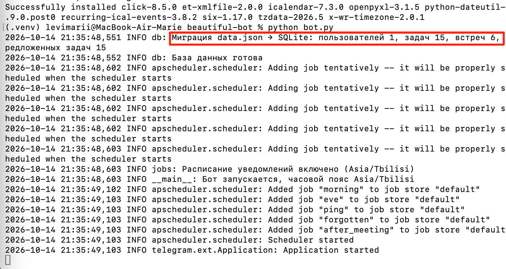

**Подключение календаря:** бот проверил ссылку и удалил её из чата.

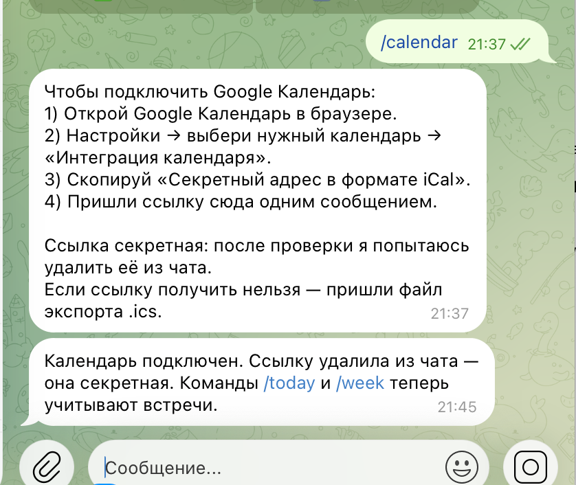

**`/today` — встречи из Google Календаря и задачи на сегодня:**

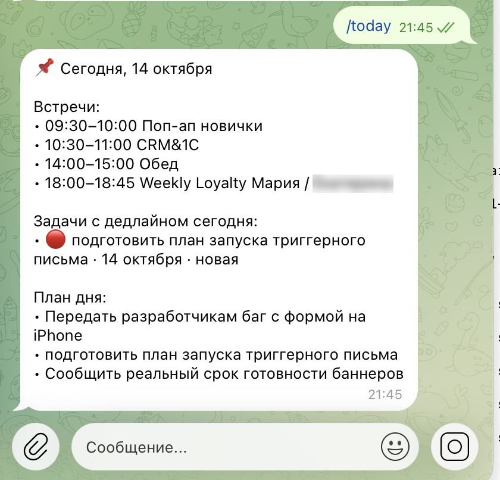

**`/week` — план с учётом занятости каждого дня** (первая версия и финальное оформление):

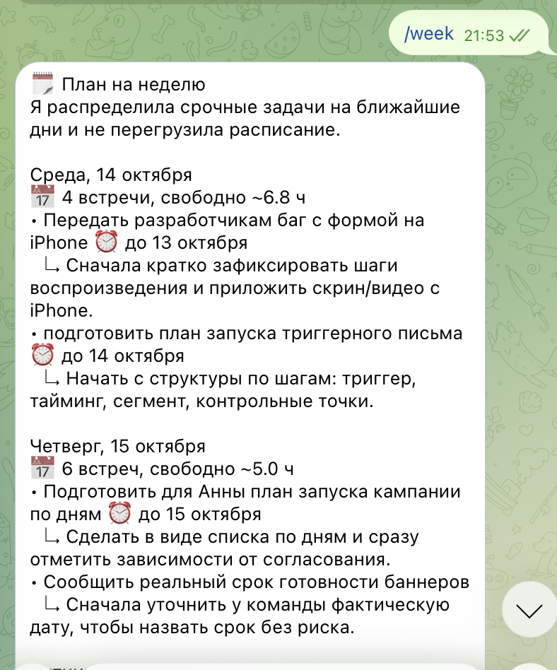
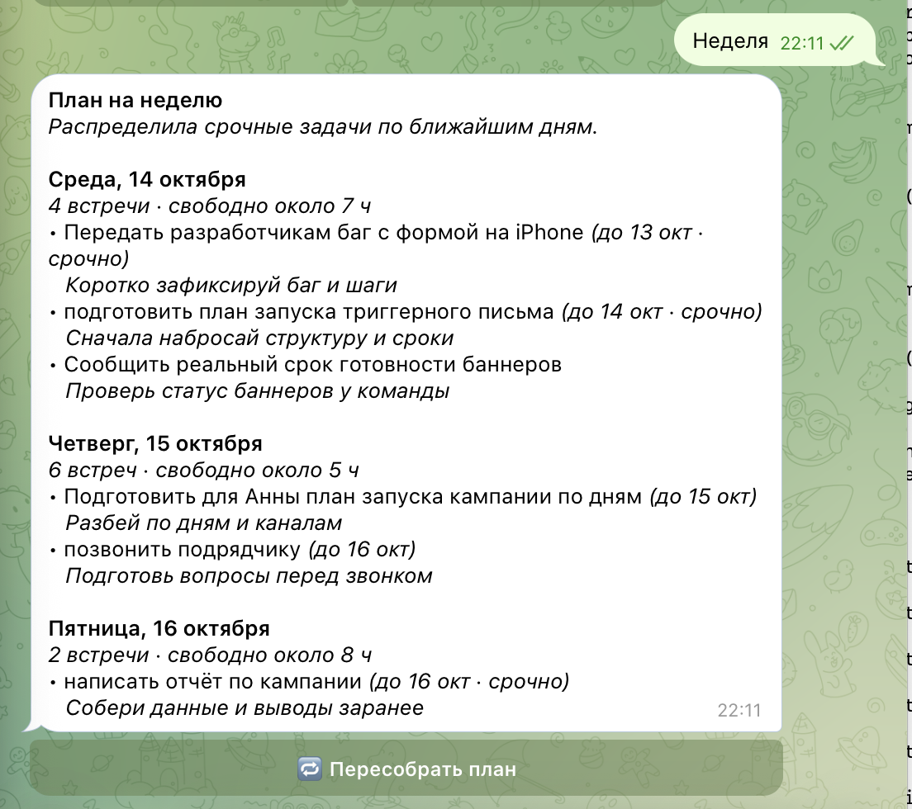

**История и статистика из базы:**

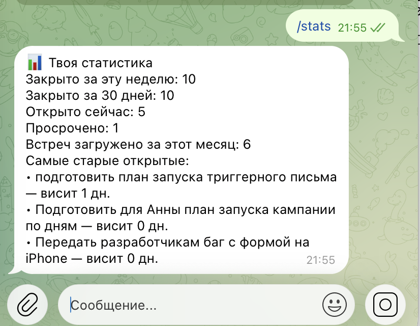
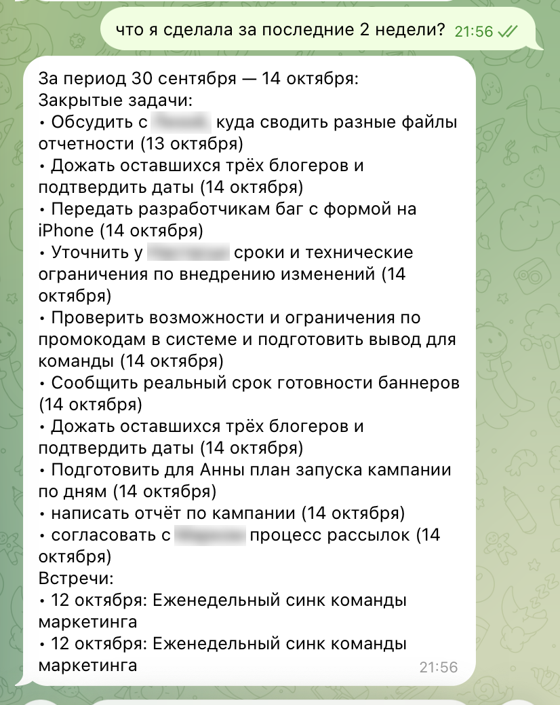

**Excel, срок задачи текстом, отзыв и админ-статистика:**

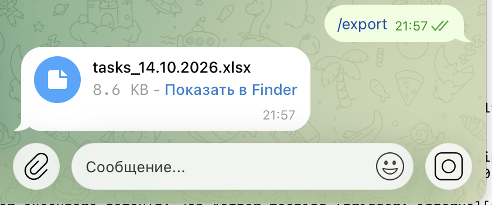
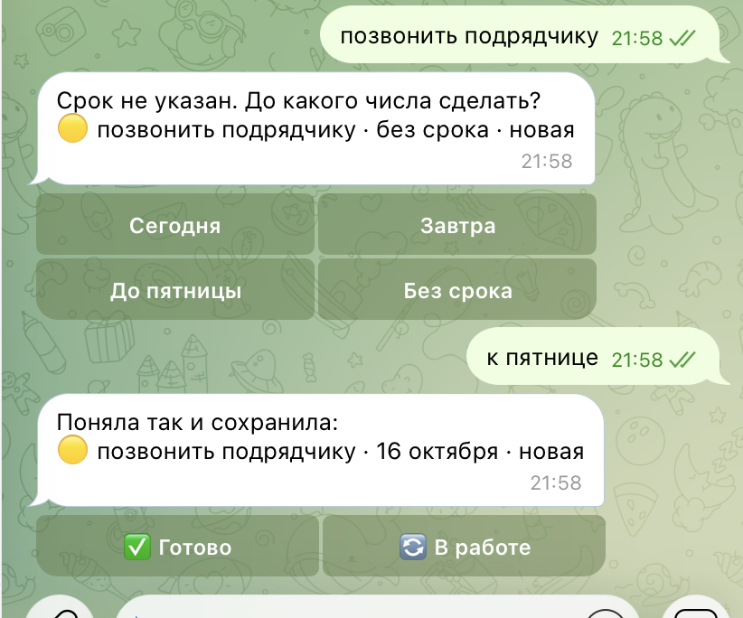
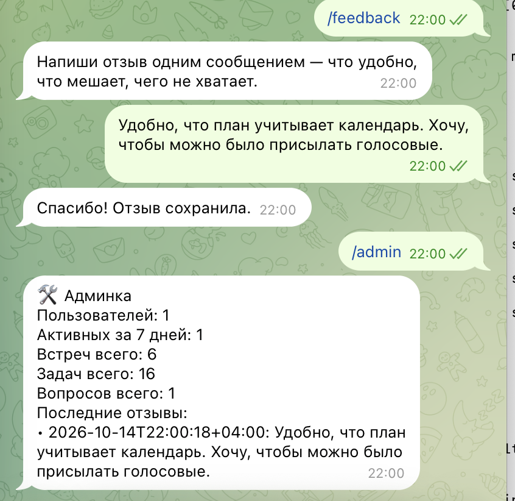

**Меню команд и кнопки под полем ввода:**

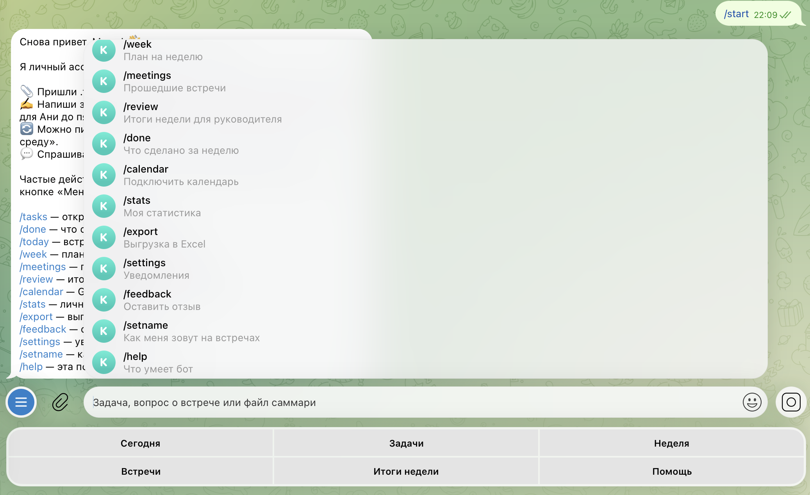

**Задачи: новое оформление и компактные кнопки «Готово»** (вверху старая версия, внизу новая):

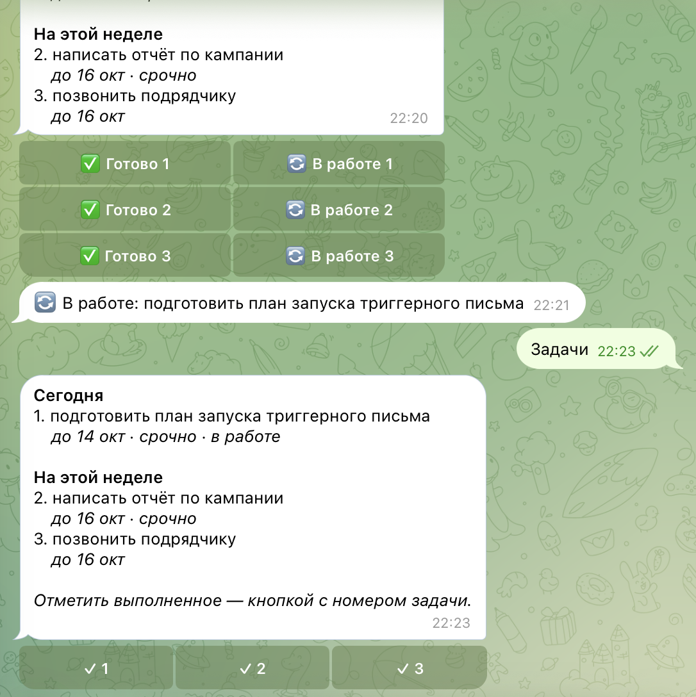

На скриншотах с реальными рабочими встречами имена коллег размыты.

### Примеры запросов и ответов

| Запрос | Ответ бота | Источник данных |
|---|---|---|
| `/today` | «Встречи: 09:30–10:00 Поп-ап новички, 10:30–11:00 CRM&1С…», дедлайны и план дня | Google Календарь + SQLite |
| `/week` | «Четверг, 15 октября — 6 встреч · свободно около 5 ч» и 2 задачи на этот день | Google Календарь + SQLite + LLM |
| `что я сделала за последние 2 недели?` | «За период 30 сентября — 14 октября: закрытые задачи… встречи…» | SQLite (период определила LLM) |
| `/stats` | «Закрыто за неделю: 10, открыто: 5, просрочено: 1…» | SQLite |
| `/export` | файл `tasks_14.10.2026.xlsx` с тремя листами | SQLite → Excel |
| `позвонить подрядчику` → `к пятнице` | «Записала: позвонить подрядчику, до 16 окт» | LLM + SQLite |
| повторная отправка того же `.txt` | «Это саммари уже загружено… Повторно не добавляю» | SQLite (отпечаток файла) |

### Видео-демо

[Смотреть на Google Диске](https://drive.google.com/file/d/1WwqgwIY5PTHI59WTJrJAhvbnCLdh9qwp/view?usp=sharing)

## 5. Трудности и решения

### Генерация кода

| Проблема | Решение |
|---|---|
| У Cursor закончился бесплатный лимит **посреди генерации** — модули написаны, служебные файлы нет | Проверила, что успел сделать агент (все модули компилировались), и доделала с помощью Claude — методичка разрешает любую LLM |

### Ревью кода, написанного Cursor (до запуска)

| # | Проблема | Чем грозила | Решение |
|---|---|---|---|
| 1 | Сохранение пользователя: задачи удалялись и вставлялись заново **отдельными коммитами** | Сбой посередине — потеря всех задач | Всё сохранение — одна транзакция |
| 2 | Если на вопрос «до какого числа?» ответить текстом, бот этого не понимал | Задача «зависала» | Ответ текстом разбирается нейросетью («к среде», «без срока») |
| 3 | После `/calendar` любое сообщение считалось ссылкой | Пользователь «застревал» | Не ссылка — выход из режима подключения |
| 4 | `/today` и утренняя сводка брали план **прошлой** недели | Неверный план дня | Используется только план текущей недели |
| 5 | В понедельник итоги недели заменяли сводку, и встречи дня пропадали | Нет встреч в понедельник | Встречи отправляются отдельным сообщением |
| 6 | «Забытые» задачи — по сообщению на каждую | 20+ сообщений в пятницу | Одна сводка и не больше 5 карточек |
| 7 | Утренняя рассылка сохраняла устаревшую копию данных | Затирание свежих изменений | Точечное обновление только итогов |

### Живое использование

| Проблема | Как обнаружена | Решение |
|---|---|---|
| В рабочем Google-аккаунте раздел «Интеграция календаря» спрятан ниже «Импорта и экспорта» — не смогла найти по инструкции бота | Сама споткнулась при подключении | Инструкция переписана по шагам, добавлены Apple Календарь и запасной вариант с файлом `.ics` |
| Календарь из файла не обновляется | Вопрос при подключении | Бот предупреждает и советует обновлять раз в неделю или подключить ссылку |
| «Обед» считался встречей — бот попросил бы прислать саммари обеда | `/today` на реальном календаре | Напоминание только после встреч с участниками, исключение личных блоков по словам |
| Одно саммари загружено дважды → дубли встречи и «открытые» задачи, которые уже закрыты | Ответ на вопрос об истории, список `/meetings` | Отпечаток содержимого файла; для старых встреч — сравнение даты и темы; дубли удалены из базы (с резервной копией) |
| План недели тяжело читается, цветные эмодзи приоритетов отвлекают | Моё впечатление как пользователя | HTML-разметка: заголовки жирным, срок и «срочно» курсивом, без цветных кружков |
| Подсказки под задачами в плане — общие и бесполезные («подготовь вопросы перед звонком») | Вопрос «на основе чего они пишутся?» | Нейросеть видит только название задачи — подсказки убраны, вместо них пометка «просрочена на N дней» |
| Команды приходится набирать вручную | Пожелание | Меню команд (`set_my_commands`) и постоянные кнопки «Сегодня / Задачи / Неделя / Встречи / Итоги / Помощь» |
| Кнопка «В работе» ни на что не влияла, но удваивала число кнопок | Вопрос «что она даёт?» | Убрана; кнопки «✓ 1, ✓ 2…» по 4 в ряд |

## 6. Выводы

**Что получилось хорошо**

- Бот перешёл от «записной книжки» к работе с реальными данными: он видит мой настоящий календарь и строит план с учётом того, что в четверг 6 встреч, а в пятницу одна.
- База данных открыла новые сценарии без лишней сложности: история за любой период, статистика, отзывы и журнал действий — всё это обычные SQL-запросы.
- Переход на SQLite прошёл без потери данных благодаря автоматической миграции.
- Бот готов к Лабе 3: многопользовательский, отзывы собираются командой `/feedback`, статистика использования — в `/admin`, путь к базе настраивается под хостинг.

**Что можно улучшить**

- Подключать календарь через Google API с входом в аккаунт — тогда не нужна секретная ссылка (в рабочих аккаунтах её могут запретить).
- Синхронизировать задачи с онлайн-таблицей Google Sheets, а не только выгружать файл.
- Принимать голосовые сообщения и саммари в `.docx`/`.pdf` (первый собранный отзыв — про голосовые).
- После окончания рабочего дня начинать план недели с завтрашнего дня.
- Дать пользователю удалять встречи и задачи из интерфейса (сейчас дубли пришлось чистить в базе вручную).

**Чему научилась**

- Подключать бота к трём типам данных и выбирать источник под задачу пользователя, а не «для галочки».
- Планировать миграцию данных: перенос со старого формата, резервные копии, проверка целостности.
- Проверять код агента до запуска: Cursor написал работающий, хорошо структурированный код, но ревью нашло 7 проблем, включая риск потери данных.
- Самые ценные улучшения пришли от использования бота на своих данных: спрятанная настройка календаря, «Обед» как встреча, дубли саммари, тяжёлое для чтения оформление. Это хорошая репетиция сбора обратной связи в Лабе 3.
- Удобство (оформление, кнопки, меньше лишнего текста) влияет на то, захочется ли пользоваться ботом, не меньше, чем функции.
