University: [ITMO University](https://itmo.ru/ru/)
Faculty: [FICT](https://fict.itmo.ru)
Course: [Vibe Coding: AI-боты для бизнеса](https://github.com/itmo-ict-faculty/vibe-coding-for-business)
Year: 2026/2027
Group: VibeCod УВБ 3
Author: Levina Maria Yurievna
Lab: Lab3
Date of create: 14.10.2026
Date of finished: XX.XX.2026

# Лабораторная работа 3. Запуск бота для реального использования

**Бот:** [@itmoftmi_lmy_bot](https://t.me/itmoftmi_lmy_bot) — личный ассистент по задачам и встречам (продолжение Лаб 1–2)
**Хостинг:** Railway, работает 24/7
**Код:** папка [`lab3/`](.) этого репозитория

## 1. Описание деплоя

### Какой способ выбран

**Облачный хостинг Railway** — второй вариант из методички («рекомендуется»).

| Параметр | Значение |
|---|---|
| Платформа | [Railway](https://railway.app/), план Trial ($5 кредитов) |
| Источник кода | GitHub-репозиторий, автодеплой при каждом `git push` в `main` |
| Сборка | Railpack (автоопределение Python), Python 3.13 |
| Регион | US East |
| Режим работы бота | long polling (бот сам опрашивает Telegram) |
| Хранилище | постоянный диск (Volume) `/data`, база `DB_PATH=/data/bot.db` |
| Секреты | переменные окружения Railway, в репозитории их нет |

### Почему именно этот

- **Ngrok не подходит:** бот должен работать, когда мой ноутбук закрыт. Коллеги тестировали его днём, а уведомления приходят в 9:00 и 15:00.
- **Docker + VPS — лишняя сложность:** сервер, обновления и безопасность пришлось бы настраивать вручную.
- **Railway** собирает Python-проект сам, перезапускает бота после падения и обновляет его после каждого `git push`. Ещё на нём есть **постоянный диск**, а это критично: бот хранит задачи и встречи в SQLite. Без диска база стиралась бы при каждом деплое.
- **Почему polling, а не webhook (как в методичке).** Бот работает через `run_polling()` ещё с Лабы 1. Для polling не нужен публичный URL и не нужно настраивать `setWebhook`, а при 5–10 пользователях разницы в скорости нет. Поэтому шаг «Получите URL» методички не понадобился.

### Ссылка на бота

[t.me/itmoftmi_lmy_bot](https://t.me/itmoftmi_lmy_bot)

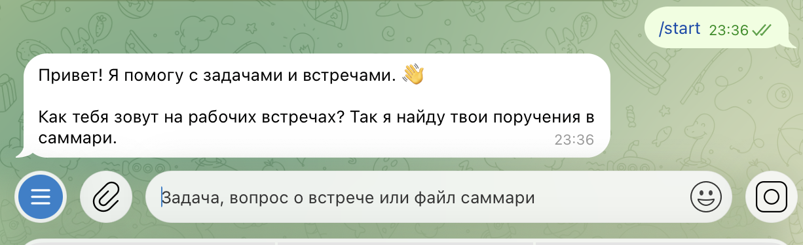

## 2. Процесс деплоя

### Подготовка кода (до деплоя)

1. **Секреты — только в переменных окружения.** `TELEGRAM_BOT_TOKEN`, `LLM_API_KEY`, `ADMIN_ID` берутся из окружения (`config.py`, `python-dotenv` для локального запуска). В `.gitignore` есть `.env`, `*.db`, `data.json`, а теперь ещё и `*.json`, чтобы случайно не закоммитить ключ Google.
2. **База — на постоянном диске.** Путь к SQLite задаётся переменной `DB_PATH`, поэтому на сервере база живёт на Volume и переживает перезапуски.
3. **Логирование.** `logging` в формате методички. Логгер `httpx` поднят до `WARNING`, потому что иначе токен бота попадает в каждую строку лога (находка Лабы 1).
4. **Часовой пояс для каждого пользователя.** На сервере Railway время UTC, а коллеги живут в разных городах. В Лабе 2 расписание уведомлений было одно на всех, по `TIMEZONE`. Теперь у каждого пользователя свой пояс (`/settings` → «Сменить часовой пояс»). Бот раз в час проверяет, у кого сейчас 9:00 или 15:00 по местному времени, и отправляет уведомления им.
5. **Встроенный сбор обратной связи** — подробнее в разделе 3.

### Пошаговая инструкция

1. Зарегистрироваться на [railway.app](https://railway.app/) через GitHub.
2. **New Project → Deploy from GitHub repo** → выбрать репозиторий `2026-vibecoding-uvb3-levina_m_yu`.
3. В корень репозитория добавить «стартер», чтобы Railway нашёл бота в папке `lab3/` (см. проблему 1):
   - `main.py` — переходит в папку `lab3` и запускает `bot.py`;
   - `requirements.txt` — одна строка `-r lab3/requirements.txt`;
   - `.python-version` — `3.13`.
4. **Variables → Raw Editor** — вставить переменные: `TELEGRAM_BOT_TOKEN`, `LLM_BASE_URL`, `LLM_API_KEY`, `LLM_MODEL`, `TIMEZONE=Europe/Moscow`, `DB_PATH=/data/bot.db`, `ADMIN_ID`.
5. **Add Volume** с точкой монтирования `/data`.
6. **Deploy** → дождаться статуса **Active**.
7. Остановить локальную копию бота на ноутбуке (см. проблему 3) и проверить `/start` в Telegram.
8. Позже, для онлайн-таблиц, добавлена ещё одна переменная — `GOOGLE_SERVICE_ACCOUNT_JSON` (раздел 5).

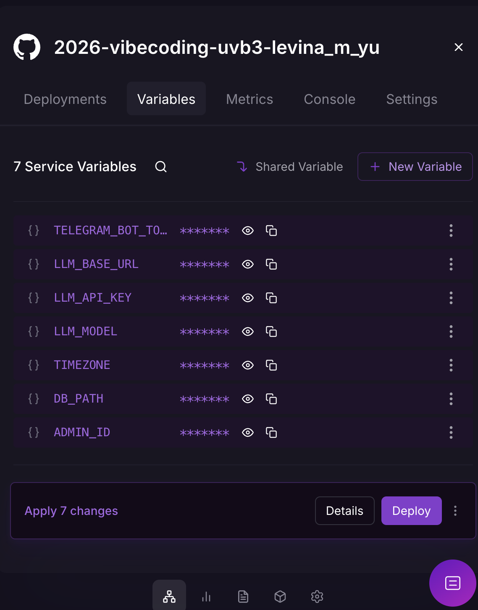

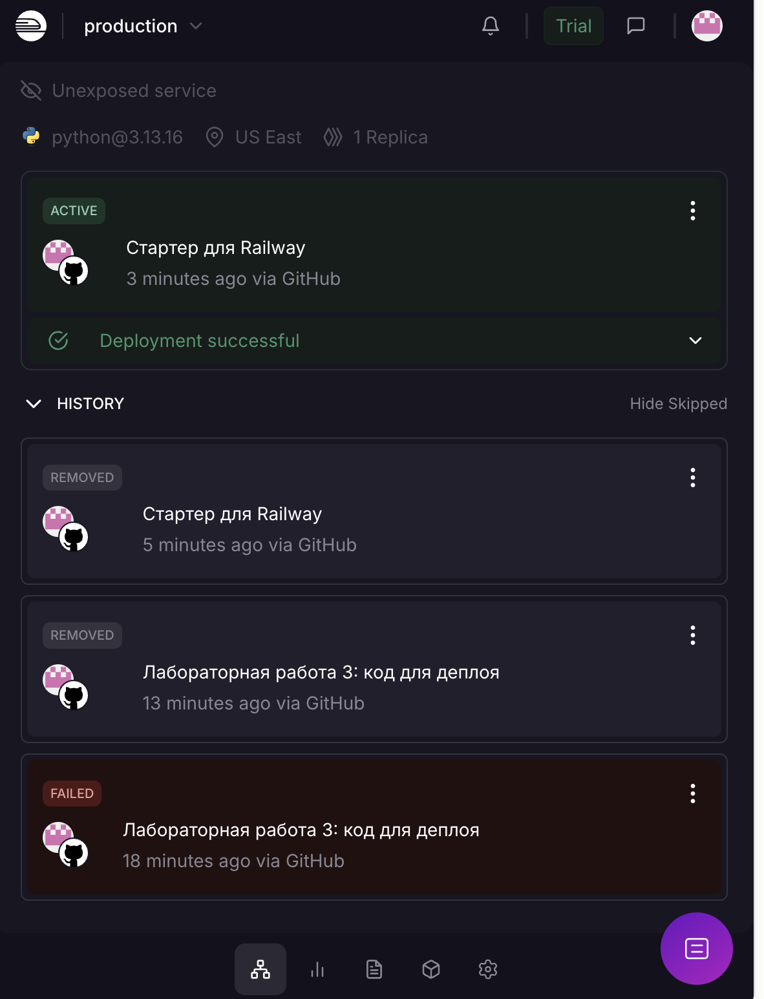

### С какими проблемами столкнулась и как решила

| # | Проблема | Причина | Решение |
|---|---|---|---|
| 1 | Первая сборка упала: *«Railpack could not determine how to build the app»* | В корне репозитория нет Python-файлов: код лежит в `lab1/`, `lab2/`, `lab3/`. Настройку Root Directory в интерфейсе Railway я не нашла | Корневой «стартер» `main.py` + `requirements.txt` + `.python-version`. Railway видит обычный Python-проект, а стартер запускает `lab3/bot.py` |
| 2 | Переменные из `.env` вставились с ошибкой | В моём `.env` у строк были пробелы в начале | Скрипт подготовил очищенную копию для Raw Editor, не показывая значения в терминале. Копию сразу удалила |
| 3 | В логах `telegram.error.Conflict: terminated by other getUpdates request` | Бот одновременно работал на ноутбуке и на Railway, а Telegram разрешает только одного «слушателя» | Остановила локальную копию (`pkill -f bot.py`). Правило на будущее: локально запускать бота только с отдельным тестовым токеном |
| 4 | Уведомления приходили бы не вовремя | Сервер работает в UTC | Пояс каждого пользователя хранится в базе (см. «Подготовка кода», п. 4) |

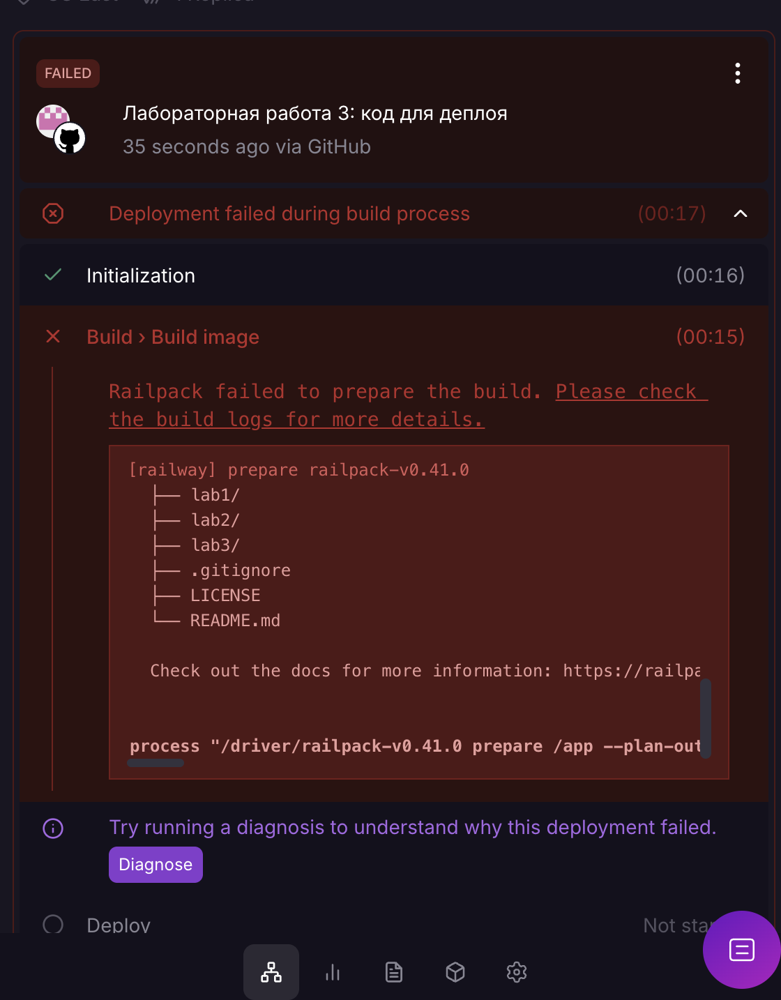

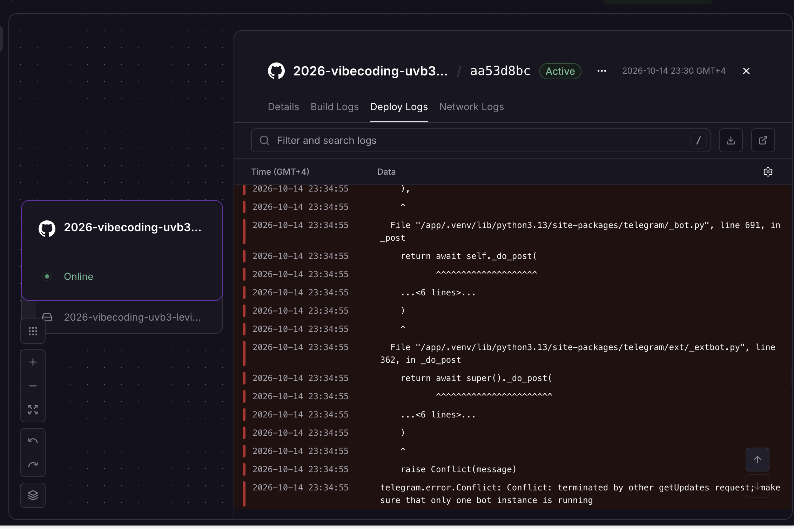

### Стабильность и стоимость

- С 14.10 бот работает на Railway без падений. После каждого `git push` (за два дня их было около десяти) новая версия поднимается за 2–3 минуты, а данные пользователей сохраняются на диске.
- **Хостинг:** укладываемся в пробные $5 Railway.
- **Нейросеть:** за всё время, включая тесты коллег, потрачено **$0.12 из $10** лимита (команда `/usage`).

## 3. Сбор фидбека

### Как собирала

1. **Приглашение.** Разослала коллегам сообщение со ссылкой на бота. Начинается оно с проблемы, которую бот решает: «на встрече договорились о десятке вещей, а через неделю никто не помнит, кто что обещал». Дальше — 4 шага, как начать.
2. **Опрос внутри бота** (`/survey`). В 19:00 по местному времени бот сам предлагает пройти опрос тем, кто открыл бота хотя бы 6 часов назад и сделал в нём не меньше трёх действий. Вопросы повторяют методичку и добавляют вопрос о цене:
   1. Что понравилось? Что оказалось полезным?
   2. Что не понравилось, мешало или работало не так, как ожидал(а)?
   3. Что улучшить или добавить?
   4. Пользовался(-ась) бы ботом дальше? (кнопки: да / скорее да / скорее нет / нет)
   5. Сколько был(а) бы готов(а) платить в месяц? (0 ₽ / до 100 ₽ / 100–300 ₽ / 300+ ₽). Этот вопрос добавлен вечером, после первой волны ответов.
3. **`/feedback`** — свободный отзыв в любой момент (из Лабы 2).
4. **Устные отзывы в личных сообщениях.** Коллеги чаще отвечали мне напрямую, чем в боте.
5. **Статистика.** `/admin` показывает пользователей, активных за 7 дней, встречи, задачи и вопросы. `/admin_export` выгружает Excel с листами «Пользователи», «Опрос», «Отзывы», «Действия по дням».

### Количество пользователей

**4 коллеги** протестировали бота и дали обратную связь (устно, в личных сообщениях).

<!-- ЗАПОЛНИТЬ по /admin: пользователей всего, активных за 7 дней, встреч, задач, вопросов, сколько прошли опрос -->

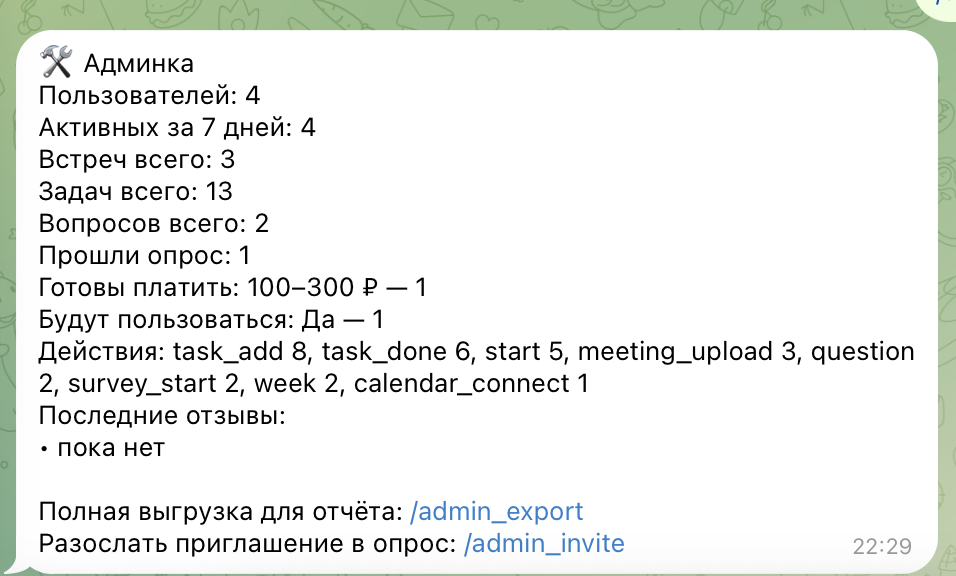

### Отзывы

| Коллега | Отзыв (пересказ, без имён) |
|---|---|
| Коллега 1 | Не поняла, как подключить календарь, и не заметила, что у бота есть меню |
| Коллега 2 | Хочет, чтобы задачи были ещё и в онлайн-таблице |
| Коллега 3 | Просит добавлять задачи голосовыми сообщениями |
| Коллега 4 | Говорит, что такой бот нужен, но у неё нет транскрибатора встреч: сервисы платные, и она не понимает, как ими пользоваться |

<!-- ЗАПОЛНИТЬ: скриншот(ы) переписки с отзывами, имена размыть → screenshots/16_feedback.png -->

## 4. Анализ фидбека

### Что понравилось

- **Сама идея нужна** — это прямо сказала коллега 4, и никто из коллег не назвал бота бесполезным. Задача «не терять договорённости со встреч» знакома всем.
- Пожелания касаются не того, *что* бот делает, а *как* до этого добраться: найти функцию, ввести данные, посмотреть результат.

### Главные проблемы

Отзывы сводятся к трём проблемам:

| Проблема | Отзывы | Суть |
|---|---|---|
| **A. Функции трудно найти** | коллега 1 | Возможности перечислены в длинном `/help`, но новый пользователь его не читает. Меню внизу экрана легко не заметить, а календаря в меню не было вовсе |
| **B. Трудно ввести данные** | коллеги 3, 4 | Бот ждёт готовое саммари `.txt`, а его нет у тех, кто не пользуется транскрибатором. Печатать задачи с телефона неудобно |
| **C. Данные заперты в боте** | коллега 2 | Посмотреть задачи можно только в чате. Excel из `/export` — это снимок на момент выгрузки, он сам не обновляется |

### Приоритеты улучшений

| Приоритет | Улучшение | Почему так |
|---|---|---|
| 1 | Первые шаги после знакомства + кнопка «Календарь» в меню | Если человек не нашёл функцию, для него её нет. Работы мало, а пользу почувствует каждый новый пользователь |
| 2 | Итоги встречи обычным текстом (без файла и транскрибатора) | Снимает главный барьер входа: коллега 4 из-за него вообще не смогла попробовать основную функцию |
| 3 | Онлайн-таблица в Google Таблицах | Новый сценарий: смотреть задачи с компьютера и показывать их другим |
| 4 | Голосовые сообщения | Удобно, но есть альтернатива: писать текстом. К тому же упирается в ограничения нейросети (см. ниже) |

## 5. Улучшения

Все изменения сгенерированы с помощью ИИ-ассистента по отзывам. Перед деплоем каждое проверено на имитации: тестовые «апдейты» Telegram, подменённые ответы нейросети и Google. После деплоя — проверено вживую.

### 5.1. Первые шаги и меню (коллега 1) ✅

**Было:** после ввода имени бот присылал весь `/help`, около 20 строк. Календарь подключался только командой `/calendar`.

**Стало:**
- После знакомства приходят два коротких сообщения. Первое показывает, что внизу экрана есть меню, и перечисляет кнопки. Второе — «С чего начать» в 3 шага с кнопками **«Разобрать пример саммари»**, **«Подключить календарь»**, **«Сменить часовой пояс»**.
- **«Разобрать пример саммари»** присылает файл-пример с именем пользователя и сразу его разбирает. Новый пользователь за 10 секунд видит, как бот находит задачи, даже если своей встречи под рукой нет.
- В меню добавлены кнопки **«Календарь»** и **«Таблица»**. Чтобы меню не занимало полэкрана, оно уложено в два компактных ряда по 4 кнопки («Итоги недели» → «Итоги»). Размер и цвет кнопок задаёт само приложение Telegram, бот их изменить не может.
- `/today` и `/week` без подключённого календаря подсказывают его подключить; в `/today` для этого есть кнопка.
- В `/help` объяснено, где найти меню, если оно скрыто: значок с четырьмя квадратиками в поле ввода.

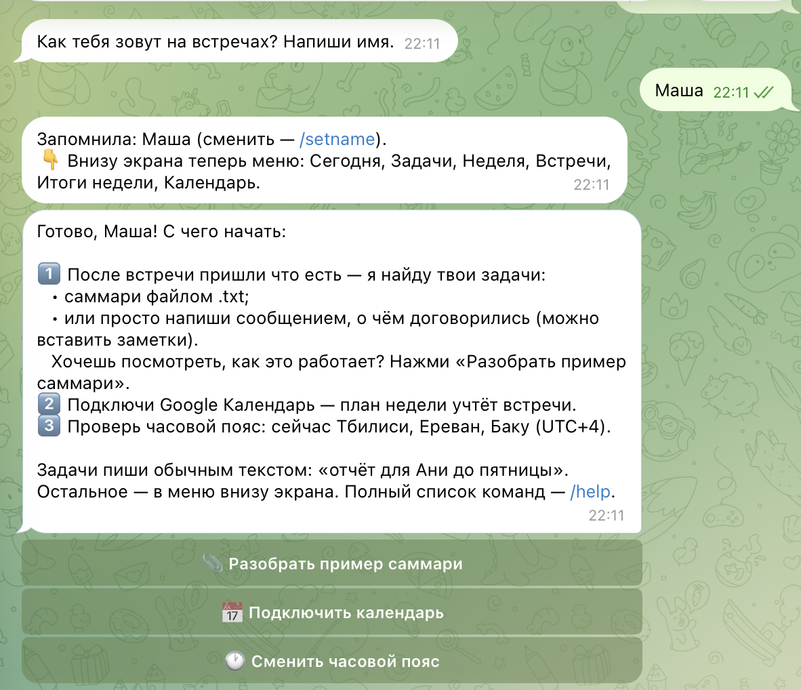

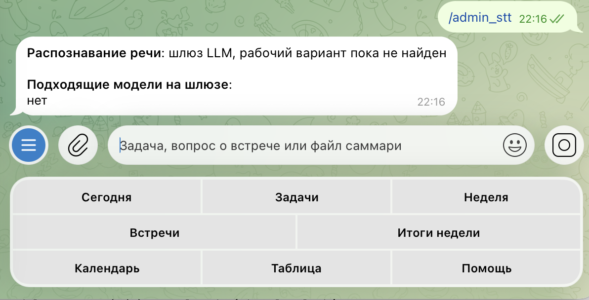

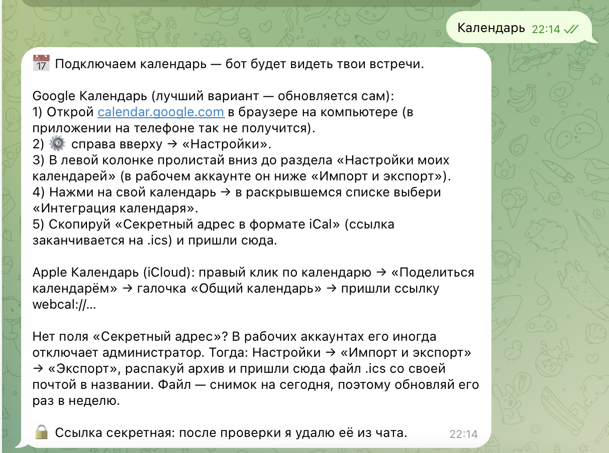

### 5.2. Итоги встречи без транскрибатора (коллега 4) ✅

**Было:** задачи из встречи бот доставал только из файла `.txt`.

**Стало:** можно просто написать сообщением, о чём договорились, или вставить свои заметки. Если текст длиннее 400 символов, бот понимает, что это не одна задача, а итоги встречи: сохраняет встречу в историю и предлагает найденные задачи кнопками, как для файла.

Промпт разбора встречи дополнен: текст может быть сырой расшифровкой или пересказом от первого лица («с меня отчёт» означает задачу самого пользователя). Лимит текста поднят с 20 до 80 тысяч символов, чтобы помещалась расшифровка часовой встречи.

### 5.3. Онлайн-таблица в Google Таблицах (коллега 2) ✅

**Было:** только `/export` — Excel-файл, который сам не обновляется.

**Стало:** кнопка **«Таблица»** (`/sheets`). Пользователь создаёт пустую Google Таблицу, даёт доступ почте бота и присылает ссылку. Бот заполняет два листа:
- **«Задачи»** — статус (просроченные помечены), задача, срок, приоритет, из какой встречи, когда создана и выполнена;
- **«Встречи»** — дата, тема, участники, краткое содержание, решения.

**Как устроено:**
- У бота есть *сервисный аккаунт* Google Cloud — технический пользователь со своей почтой. Ключ хранится в переменной Railway `GOOGLE_SERVICE_ACCOUNT_JSON` (в base64), в репозитории его нет.
- Раз в минуту бот считает «отпечаток» (SHA-256) данных пользователя и обновляет таблицу только если что-то изменилось. Так он не тратит лимиты Google API. Есть и кнопка «Обновить сейчас».
- Синхронизация односторонняя, бот → таблица. Задачи меняются в боте, а таблица служит удобной витриной.
- После первого живого теста по моей просьбе добавлены: перенос текста в ячейках, ширина колонок и удаление пустого «Лист1».
- Библиотека: `gspread`.

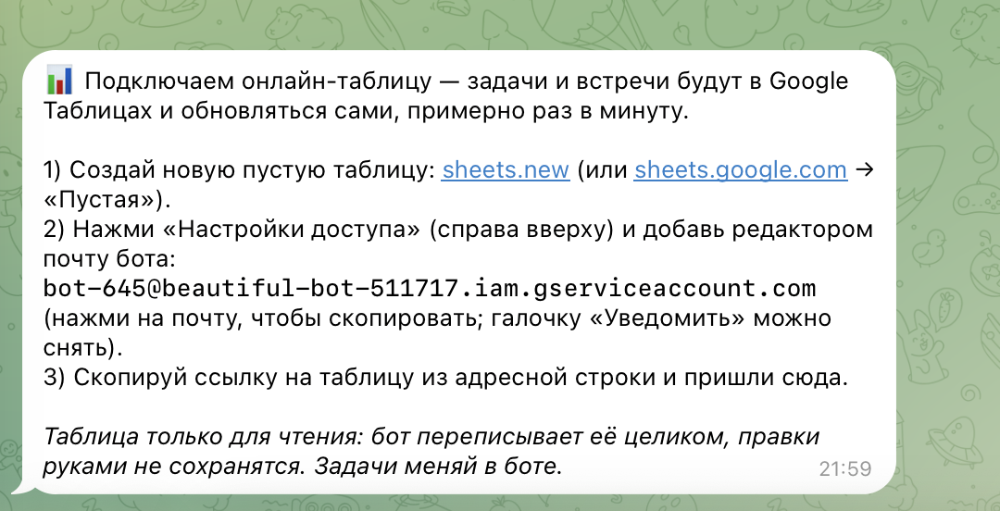

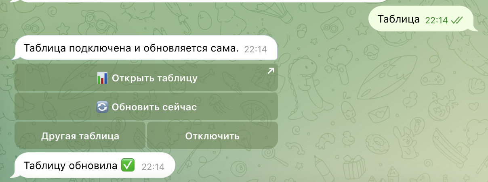

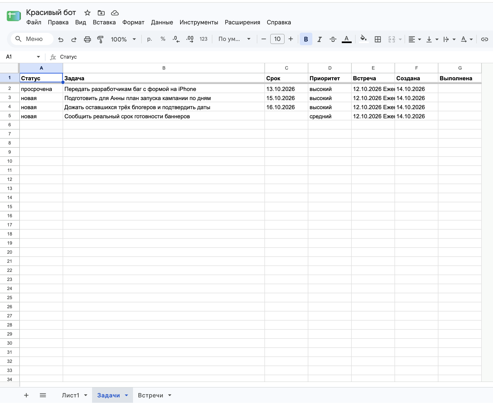

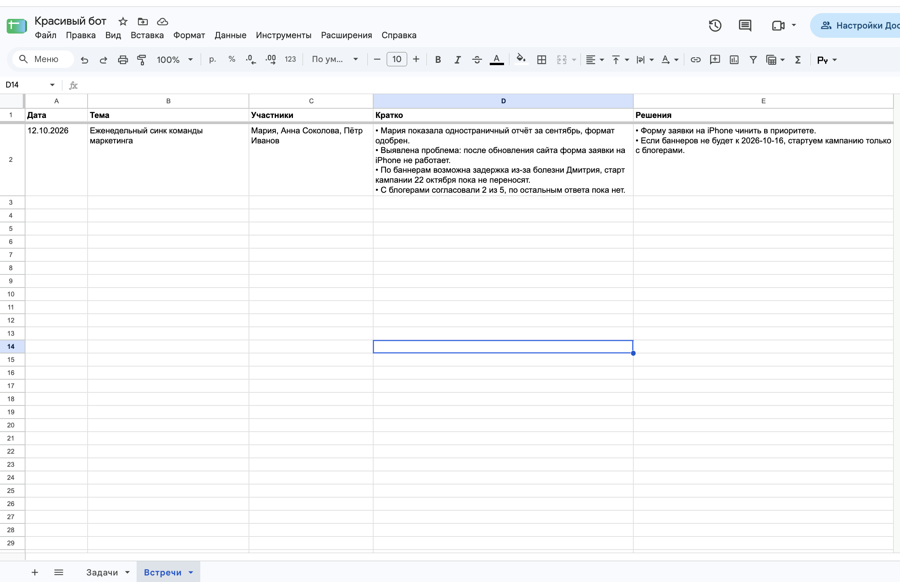

### 5.4. Голосовые и записи встреч (коллеги 3 и 4) — реализовано, но упёрлись в ограничение нейросети ⚠️

**Что сделано в коде** (`stt.py`):
- голосовое до 10 минут бот распознаёт в текст и обрабатывает как обычное сообщение: задачу, статус, вопрос, а длинное — как пересказ встречи;
- аудиозапись встречи до 60 минут (в том числе файл из «Диктофона» iPhone) бот расшифровывает и разбирает как саммари;
- бот пробует два способа: Whisper-совместимый API `/audio/transcriptions` и мультимодальные модели, которым звук передаётся прямо в чат (`input_audio`);
- для диагностики добавлена админ-команда `/admin_stt`.

**Что показала проверка на сервере.** Шлюз LLM курса отклонил все попытки:

```
transcriptions openai/whisper-1: HTTP 403
{"error":{"message":"key not allowed to access model. This key can only access
models=['openai/gpt-5.4-mini', 'z-ai/glm-5.3', 'z-ai/glm-5.3-flash']. ..."}}
chat google/gemini-2.5-flash: HTTP 403 (то же сообщение)
```

Ключ курса открывает только три текстовые модели, и ни одна из них не понимает речь.

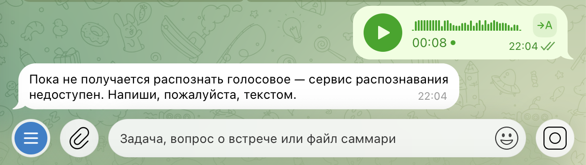

**Решение.** Подключать сторонний сервис распознавания (например, бесплатный Groq Whisper) я не стала: это ещё один аккаунт и ещё один ключ ради функции с низким приоритетом. Поэтому:
- распознавание выключено, но код остался: оно включится переменной `STT_API_KEY`, если появится доступ к модели речи;
- на голосовое бот честно отвечает, что работает только с текстом, и предлагает вставить заметки встречи текстом. Это и есть улучшение 5.2;
- из подсказок голосовые убраны, чтобы бот не обещал того, чего не умеет.

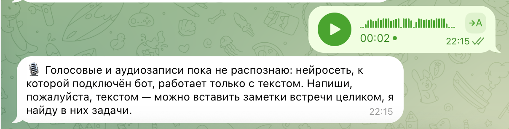

### 5.5. Прочие изменения за время теста

- **Часовой пояс в `/settings`** — по просьбе на этапе подготовки (пояс по умолчанию — Москва).
- **Уведомления сокращены до двух в день:** сводка в 9:00 (в понедельник — итоги недели) и напоминание в 15:00 о задачах со сроком сегодня. Убраны напоминание «завтра срок» в 18:00 (дублировало утреннюю сводку) и пятничный список «забытых» задач.
- **5-й вопрос опроса** — готовность платить, для оценки монетизации.

### Как это помогло

| Отзыв | До | После |
|---|---|---|
| Не нашла календарь и меню | Функции только в `/help` и командах | «С чего начать» с кнопками, «Календарь» и «Таблица» в меню, подсказки в `/today` и `/week` |
| Хочу онлайн-таблицу | Excel-снимок | Google Таблица, обновляется сама раз в минуту |
| Задачи голосом | — | Код готов, но ключ курса не даёт доступа к модели речи. Бот честно об этом говорит |
| Нет транскрибатора | Только файл `.txt` | Итоги встречи можно написать или вставить текстом |

### Новый фидбек

<!-- ЗАПОЛНИТЬ после того, как коллеги посмотрят новую версию: что сказали про первые шаги и таблицу -->

## 6. Выводы

### Что получилось хорошо

- **Бот работает 24/7 в облаке** и обновляется одним `git push`. Данные пользователей переживают каждый деплой благодаря постоянному диску.
- **Сбор обратной связи встроен в продукт:** опрос приходит сам в удобное время, а ответы выгружаются одной командой в Excel. Не пришлось собирать ответы по чатам и формам.
- **Три из четырёх отзывов закрыты в тот же вечер.** Онлайн-таблица — полностью новая интеграция с Google Sheets API.

### Что можно улучшить дальше

- **Голосовые:** подключить отдельный сервис распознавания речи — код уже готов, нужен только ключ.
- **Двусторонняя таблица:** отмечать задачи выполненными прямо в Google Таблице.
- **Монетизация.** Если пользователь загружает стенограмму каждой встречи, нейросеть стоит около 140 ₽ в месяц. При цене 100 ₽ модель убыточна. Нужны тарифы (например, лимит загрузок в базовом) и более дешёвая модель для разбора встреч.
- **Тестовый бот.** Отдельный токен для локальной разработки, чтобы не было конфликта с боевым ботом.

### Чему научилась

- **Деплой — это не «загрузить код».** Пришлось разобраться, как хостинг определяет тип проекта, где хранить секреты, почему два экземпляра бота конфликтуют и зачем базе постоянный диск.
- **Пользователи спотыкаются не там, где ждёшь.** Мне казалось, что главное в боте — разбор встреч и план недели. А коллеги споткнулись на входе: не нашли меню, не смогли подать данные. Самые дешёвые улучшения (первые шаги и кнопки в меню) оказались самыми важными.
- **Внешние ограничения нужно проверять на реальном окружении, а не в теории.** Код распознавания речи прошёл все тесты на имитации. О том, что ключ курса открывает только текстовые модели, стало известно только из ошибки 403 на сервере. Диагностическая команда `/admin_stt` дала ответ за минуту, без чтения логов.
- **Честный отказ лучше сломанной функции.** Если бот обещает голосовые и не может их распознать, это хуже, чем прямое «работаю только с текстом» с понятной альтернативой.
